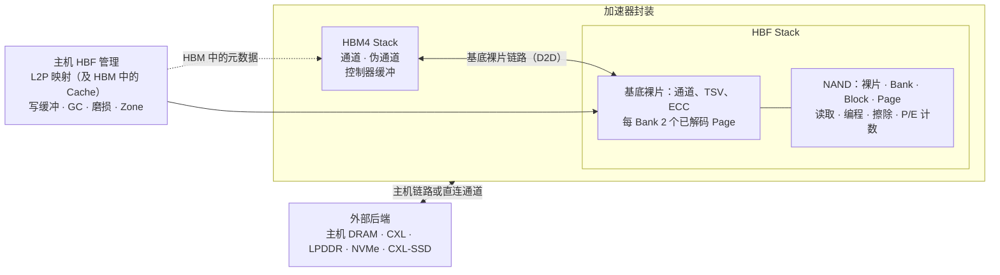

# 概念

> 状态：当前版本（Current）  
> 最近审核日期：2026-10-17

本页介绍有效使用 HBFSim 所需的最低限度背景：什么是 HBF、模拟器建模了什么、一次运行如何流转，以及其他文档通用的术语。精确契约见[模型参考文档](reference/model.md)。

## 一页了解 HBF

High-Bandwidth Flash（高带宽闪存，HBF）像 HBM 堆叠 DRAM 一样，在基底裸片上通过硅通孔堆叠 NAND Flash 裸片，并把整个 Stack 连接到处理器封装。[OCP HBF v0.7.0 规范](https://www.opencompute.org/documents/ocp-hbf-architecture-specification-v0-7-0-final-pdf)定义了三个接口速度等级：

| 等级 | 每 Stack 通道数 | 每通道 Payload | 每 Stack 最大 Payload |
| --- | ---: | ---: | ---: |
| 1 | 8 | 48 GB/s | 384 GB/s |
| 2 | 16 | 96 GB/s | 1536 GB/s |
| 3 | 16 | 192 GB/s | 3072 GB/s |

与 HBM 相比，一个 HBF Stack 的容量大得多，但 Flash 的以下特性决定了它能否胜任内存用途：

- **读取以 Page 为单位，启动很慢。** NAND 阵列需要数微秒感测完整的 4 KiB Page（`hbf-read-ns`，随附 Profile 中为 4 µs），而 DRAM 只需数十纳秒。带宽来自多个 Bank 并行读取，因此阵列可能比接口更早成为瓶颈。
- **写入采用追加方式，擦除粒度很大。** Page 在 Block 内按顺序编程（`hbf-program-ns`，75 µs），Block 必须擦除后才能复用。数据无法原地更新，因此 Flash 转换层（FTL）负责逻辑 Page 到物理 Page 的映射，垃圾回收器（GC）会搬走待擦除 Block 中仍有效的 Page。
- **Flash 会磨损。** 每个 Block 只能承受有限的编程/擦除（P/E）周期。GC 复制会增加写入（写放大），磨损均衡则以更多复制为代价分散擦除。
- **管理位于主机端。** OCP HBF 中的映射、写缓冲、GC 和磨损策略由主机负责；设备负责通道—Zone 布局和物理擦除计数。映射表与写缓冲占用 HBM，GC 复制和应用数据共用设备接口。

因此，数据放置是核心问题：模型权重等不可变流式数据适合 Flash；小型、热点且频繁更新的数据（如不断增长的 KV Cache）则会给它造成压力。HBFSim 用真实工作负载量化这些权衡。

## 建模范围

- **HBM4** 遵循公开的 JESD270-4 组织（32 个通道、每通道两个伪通道、每 Pin 8 Gb/s），采用聚合通道时序模型并模拟共享控制器缓冲争用；不模拟单条 ACT/PRE/Refresh 命令。
- **HBF** 遵循 OCP HBF v0.7.0：每通道命令/接收/发送 Calendar、每 Bank 一个感测资源和两个已解码 Page 槽位、顺序编程与自动擦除、ECC、内部数据路径，以及由每 Stack 一个 RC 节点驱动的四种 OCP 热模式。
- **主机管理** 支持 Page、Entry、压缩、Block、Extent 和混合映射，映射可完全驻留或在 HBM 中缓存；还包括合并写缓冲、带水位线和磨损均衡权重的 GC、Zone 及用于检查点/重启的持久镜像。
- **外部后端** 是一条请求/控制器/介质流水线，可配置为主机 DRAM、CXL 内存、封装内 LPDDR、NVMe SSD，或带可选设备端 DRAM Cache 的 CXL-SSD。

每种资源都用 Calendar 记录忙碌时段，因此争用、排队和重叠由事务自然产生，而不是由公式估算。

### 遵循的标准与模型边界

HBF 以 130 页的 OCP HBF v0.7.0 规范为准。通道拥有独立的收发 Calendar；每个 Bank 保留两个已解码 Page；NAND 按完整 4 KiB Page 追加编程，并在 Page 0 自动擦除。映射、GC、写缓冲和磨损策略属于主机；设备负责通道—Zone 置换和物理 P/E 计数，且没有 GC 或 Copyback 路径。GC 复制会消耗 HBF 读取、HBM 中有限的复制槽位、HBM 流量和 HBF 写入。主机回收和 Zone Reset 本身不增加物理擦除计数。控制器存储从应用可用 HBM 容量中扣除，其传输与应用共享 HBM 通道 Calendar；模型不假定额外共享的主机 DRAM Payload 端口。

HBM 默认值遵循公开的 JEDEC HBM4 JESD270-4 组织，使用近似访问延迟和有效通道带宽。HBF 等级不会选择 HBM 代际。HBFSim 是事务级模拟器，不用于电气或 Packet 级合规验证；其余限制见[模型参考文档](reference/model.md)。

## 一次运行如何流转

1. **工作负载**描述应用访问什么：Trace 文件、合成模式或 ServeLoop 生成的 LLM Serving 迭代。
2. **策略**决定每次访问去往哪里：HBM、经 FTL 的 HBF、静态 Flash、外部设备，或设备之间的复制。参考策略位于 `hbfsim-reference`，自定义策略可用 Python 编写。
3. **事务**携带 Target、地址、大小、发出时间和依赖关系进入引擎。引擎预留路径上的所有资源，并返回每个事务的完成时间。
4. **Receipt**汇总为结果：各设备统计、耗时分解、写放大、磨损，以及所有输入的来源信息。

引擎本身不解释语义，因此同一个物理模型可供参考套件、ServeLoop 和自定义原型共同使用。

## 两个程序、三层 Python

| 组件 | 作用 |
| --- | --- |
| `build/hbfsim` | 引擎：从 stdin 接收并执行事务 DAG 的持久会话 |
| `build/hbfsim-reference` | 使用八种参考放置策略重放 Trace，并生成 Summary JSON |
| `hbfsim`（Python） | 统一入口：build、list、run、sweep、show；策略可使用 `hbfsim.open_session` |
| `hbfsim_client`（Python） | 所有前端共用的、经过验证的事务协议和会话客户端 |
| ServeLoop（独立仓库） | 以闭环方式驱动引擎的 LLM Serving 工作负载编译器 |

## 事务 Target

| Target | 含义 |
| --- | --- |
| `HBM` | HBM 应用内存 |
| `HBF_LOGICAL` | 经过主机 FTL（映射、写缓冲、GC）的 HBF |
| `HBF_STATIC` | 固定物理 Flash 位置的不可变数据，绕过 FTL |
| `HBF_PHYSICAL` | 供显式管理布局使用的原始物理 Flash Page |
| `D2D_HBF_TO_HBM`、`D2D_HBM_TO_HBF` | 通过 Stack 基底裸片链路进行复制 |
| `EXTERNAL`、`HOST_DRAM` | 外部后端设备和主机 DRAM |
| `DIRECT_HBF_TO_EXTERNAL`、`DIRECT_EXTERNAL_TO_HBF` | 绕过 HBM 暂存的可选直连通道 |
| `BARRIER` | 仅用于排序依赖的节点 |

## 术语表

| 术语 | 含义 |
| --- | --- |
| Stack | 封装上的一个 HBM 或 HBF 设备（`hbm-stacks`、`hbf-stacks`） |
| Channel（通道） | Stack 的独立接口通道，各有自己的 Calendar |
| Bank | 一次感测或编程一个 Page 的 NAND 单元（`hbf-planes-per-die`） |
| Block / Page | 擦除单元 / 编程与读取单元（默认 Page 为 4 KiB） |
| tR、tPROG、tBERS | Page 读取、Page 编程和 Block 擦除时间 |
| Speed Grade | OCP 接口性能范围（1、2、3），不会改变 NAND 时序 |
| FTL、L2P | Flash 转换层；及其逻辑到物理 Page 的映射 |
| Mapping Cache | 完整 L2P 表无法放入 HBM 时，驻留其中的映射部分 |
| Controller DRAM Budget | 为映射和写缓冲保留并从应用容量中扣除的 HBM |
| GC | 垃圾回收：复制有效 Page、擦除 Block 并将其复用 |
| WAF | 写放大系数：每逻辑写入字节对应的 Flash 编程字节数 |
| P/E Cycle | Block 的编程/擦除计数；磨损最严重的 Block 决定设备寿命 |
| Wear Leveling | 通过选择 GC Victim 均衡擦除次数 |
| Zone | 主机统一管理的一组 Block（OCP Zone Remapping） |
| LTT、RTT、STT | OCP 热阈值：LTT 开始轻度限速，低于 RTT 后结束；STT 开始严重限速，低于 LTT 后结束 |
| CATTRIP | Stack 进入严重限速时发出的灾难温度信号；冷却前停止主机命令 |
| Base-die Link | Streaming 和复制使用的每 Stack HBM↔HBF 路径 |
| External Backing | 封装外容量层：DRAM、CXL、LPDDR、NVMe、CXL-SSD |
| Open-loop Arrival | 请求按固定时间表到达而不等待完成；延迟包含排队 |
| Makespan | 从首个请求到包括后台排空在内全部工作结束的时间 |
| Frontier | 当前 Batch 中必须在下一 Batch 开始前完成的事务 |

## 如何理解结果

结果的可信度取决于输入。[`configs/parameter-provenance.json`](../configs/parameter-provenance.json) 为每个参数记录证据等级及来源，包括 `standard_published`、`vendor_published`、`literature_derived`、`measured_calibration_with_exploratory_fallbacks`、`exploratory_assumption` 和 `implementation_policy`。例如，随附的 NAND 与 ECC 时序是明确标注的研究假设，并非产品参数。在非认证构建上生成的 Summary 会记录 `validation.status: exploratory_unattached`。应在相同输入上进行相对比较，阅读全部警告，并说明结论依赖参数的证据等级。详见[证据策略](reference/evidence-policy.md)。
